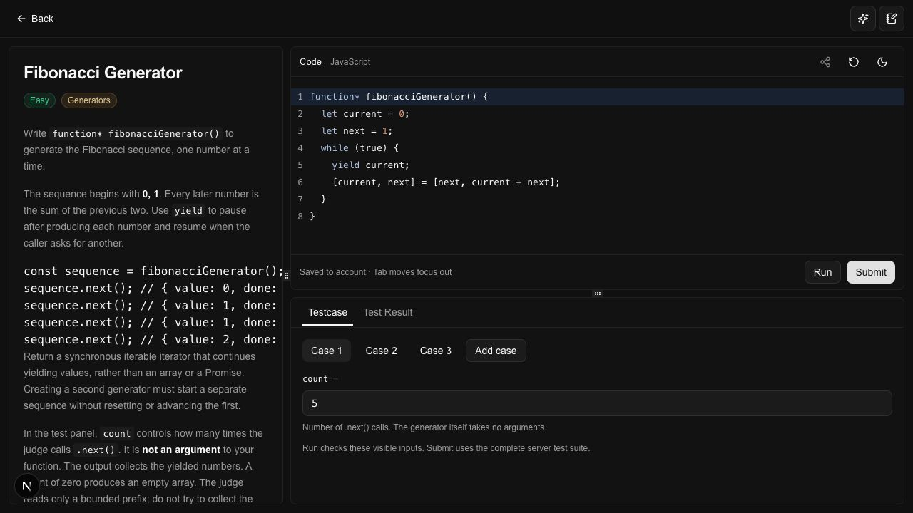
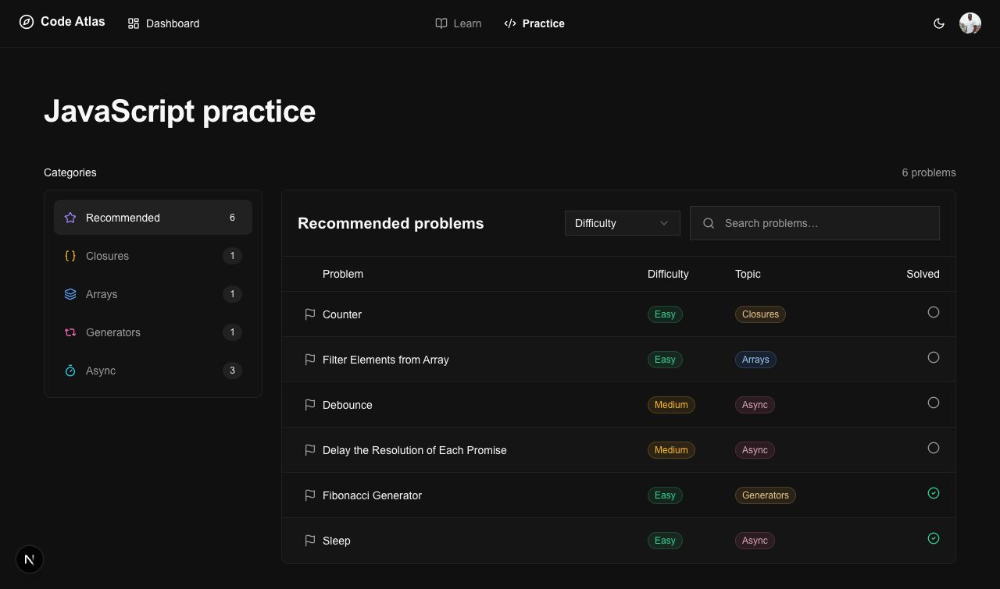
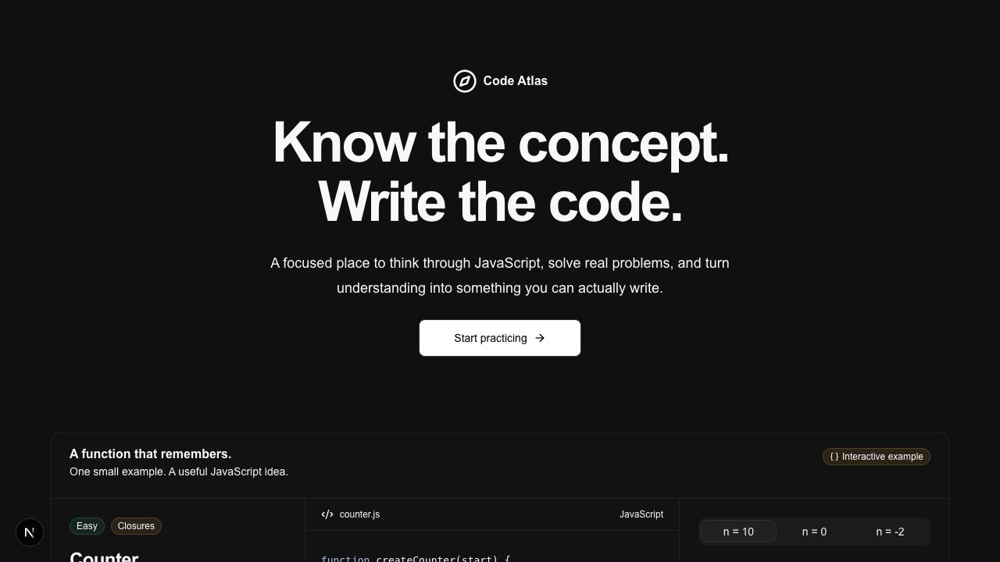
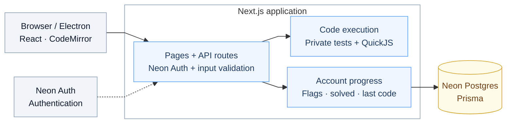

# Code Atlas

**Know the concept. Write the code.**

Code Atlas helps developers practice JavaScript through hands-on coding challenges,
real execution feedback, and progress that follows their account. JavaScript practice
is available now; guided learning and additional subjects are planned.

Built with Next.js, Electron, React, TypeScript, CodeMirror, QuickJS, Neon Auth, Neon PostgreSQL,
Prisma, and Turborepo.

## Preview

The coding workspace brings the problem, editor, and test cases together in resizable panels.



<details>
<summary>View the practice catalog and landing page</summary>

Browse thirteen challenges by topic, search, or difficulty, with account-backed flags and solved status.



The public landing page includes a Counter example that works without an account.



</details>

## How It Works

Start by choosing a JavaScript challenge, from a foundational concept like closures
to something more involved like debouncing.

Once you open a challenge, you'll see the problem description on one side and a code
editor on the other. Write your solution, experiment with different approaches, and
click **Run** to check your code against the visible test cases. You can edit these
inputs to try your own examples.

When you're ready, click **Submit**. Code Atlas evaluates your solution in an isolated
server-side JavaScript environment against the full test suite, including private
cases. You'll receive a verdict and feedback to guide your next attempt. Only an
accepted Submit marks the problem solved.

Your latest executed code is saved to your account after Run or Submit, regardless
of the verdict. Your flags and solved progress stay with your account too, so you
can pick up where you left off, even on another device.

The idea is to make learning more hands-on: **read the problem, experiment, get
feedback, and improve.**

## What works today

- **Focused practice:** CodeMirror JavaScript editor, resizable panels, hints and solutions,
  plus light, dark, and system themes.
- **Real evaluation:** Run editable visible cases, then Submit against a server-selected
  suite that includes private cases. Only an accepted Submit marks a problem solved.
- **Persistent progress:** Flag problems and restore the latest code saved after Run or
  Submit, regardless of verdict. Unsaved editor changes remain in memory.
- **Account ownership:** Neon Auth handles authentication; Prisma and Neon store each learner's
  progress behind authenticated Next.js APIs.
- **Isolated execution:** QuickJS WebAssembly runs in disposable Node.js Workers with
  resource limits. Learner code has no application filesystem, Node module, or network access.

### Available challenges

| Challenge                            | Difficulty | Concept                                |
| ------------------------------------ | ---------- | -------------------------------------- |
| Counter                              | Easy       | Closures                               |
| Curry                                | Medium     | Closures and partial application       |
| Function Composition                 | Easy       | Higher-order functions and closures    |
| Memoize                              | Medium     | Closures and cached results            |
| Filter Elements from Array           | Easy       | Arrays and callbacks                   |
| Map Array                            | Easy       | Arrays and transformation callbacks    |
| Reduce Array                         | Easy       | Arrays and accumulator callbacks       |
| Chunk Array                          | Easy       | Array grouping and non-mutating copies |
| Flatten Nested Array                 | Medium     | Arrays and recursive traversal         |
| Debounce                             | Medium     | Timers and async behavior              |
| Delay the Resolution of Each Promise | Medium     | Promises and fulfillment timing        |
| Fibonacci Generator                  | Easy       | Generators and iterator state          |
| Sleep                                | Easy       | Promises and asynchronous execution    |

Each challenge includes a description, examples, constraints, starter code, hints,
a solution, and server-controlled evaluation.

## Quick start

Use **Node.js 24 LTS (24.11.0 or later in the 24.x series)** and **pnpm 11.25.0**.

```sh
git clone https://github.com/eric-nichols-nyc/code-atlas.git
cd code-atlas
pnpm install --frozen-lockfile
pnpm dev
```

Open <http://localhost:3000>. The public landing page runs without credentials.
Signing in and using Run/Submit require Neon Auth; saving progress also requires Neon.

### Enable accounts and saved progress

Copy these examples only when the local destination does not already exist:

| Example                    | Local destination     | Configuration                                                       |
| -------------------------- | --------------------- | ------------------------------------------------------------------- |
| `apps/web/.env.example`    | `apps/web/.env.local` | Neon Auth URL, cookie secret, and runtime `DATABASE_URL`            |
| `packages/db/.env.example` | `packages/db/.env`    | Neon `DATABASE_URL` and optional direct `DIRECT_URL` for migrations |

Enable Managed Better Auth on your Neon development branch. Set `NEON_AUTH_BASE_URL`
to its Auth URL and generate `NEON_AUTH_COOKIE_SECRET` with `openssl rand -base64 32`
(at least 32 characters). Use that same branch for `DATABASE_URL`. All three values
are server-only. Environment files containing real credentials stay ignored.

With your Neon development database configured, generate the client and apply the
committed migrations:

```sh
pnpm db:generate
pnpm db:deploy
```

Restart the development server after environment changes. Installation and production
builds work without database credentials. See the [development guide](docs/development.md#environment-and-authentication)
for auth behavior, connection details, and troubleshooting.

## System architecture

The browser and Electron client use one Next.js application serving pages and same-origin API Route Handlers. Privileged services
stay on the server, and learner code runs in an isolated QuickJS worker.



Protected pages and APIs verify Neon Auth identity. Problem content stays in source files;
Neon stores flags, verified solved status, and the latest executed code.

## Desktop app

Run Code Atlas in its own desktop window:

```sh
pnpm desktop:dev
```

This starts the local web server when needed and opens Electron. Accounts, Run/Submit,
and progress use the same backend as the website. Desktop has its own sign-in session;
use email and password. Google sign-in is available in the browser version.

`pnpm desktop:package:local` creates an unsigned Mac app in `apps/desktop/release/`.
Keep `pnpm dev` running when opening that local app. For other computers, package with
your deployed URL: `CODE_ATLAS_DESKTOP_URL=https://your-code-atlas.example pnpm desktop:package`.
Server credentials stay on the server. Offline use and signed distribution are deferred.
See the [desktop guide](docs/development.md#electron-desktop).

## Development checks

```sh
pnpm lint
pnpm typecheck
pnpm test
pnpm build
```

These are the same checks run by [GitHub Actions](.github/workflows/ci.yml) for pull
requests targeting `main` and pushes to `main`. Biome handles linting and formatting;
Vitest covers unit and integration behavior.

`pnpm test:e2e` runs the production Playwright smoke suite after a credential-free
build, with port 3000 available. Optional authenticated automation requires a dedicated
Neon Auth development test user and remains unverified. See [verification instructions](docs/development.md#verification)
and the [full command list](docs/development.md#commands).

## What's next

Guided Learn content, additional JavaScript and algorithm challenges, connected AI
tutoring, saved notes, submission history, and signed desktop distribution are planned.
AI and notes controls currently show placeholders. Hosted deployment is not yet configured.

## Documentation

- [Development guide](docs/development.md) — setup, code ownership, problem authoring, API, database, testing, and deployment.
- [Feature briefs](docs/features) — scope, decisions, and verification for each feature.
- [Feature workflow](.agents/skills/feature-workflow/SKILL.md) — one short brief, one working slice, browser review, and relevant checks.
- [UI registry](ui-registry.md) and [constitution](.specify/memory/constitution.md) — shared patterns and project principles.

A project license has not yet been selected.
