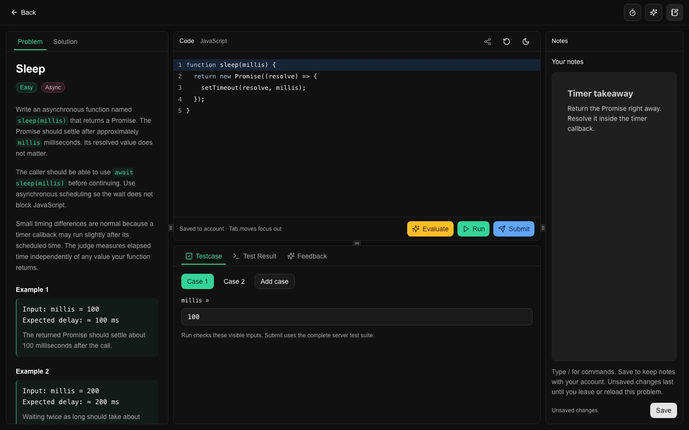
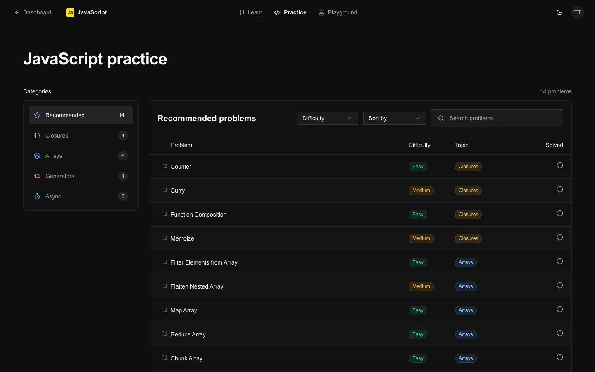
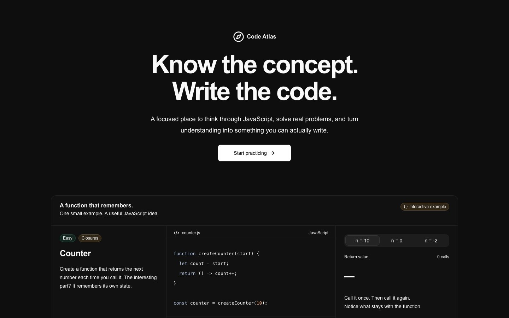
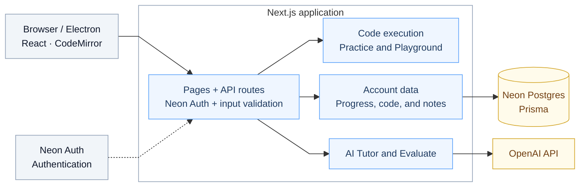

# Code Atlas

**Know the concept. Write the code.**

Practice JavaScript and Algorithms with hands-on challenges, real execution feedback, and
account-backed progress. Run your own scripts in JavaScript Playground or follow guided
walkthroughs in JavaScript, Algorithms, and React Learn.

Built with Next.js, Electron, React, TypeScript, CodeMirror, QuickJS, Neon Auth, Neon PostgreSQL,
Prisma, and Turborepo.

## Preview

The coding workspace brings the problem, editor, and test cases together in resizable panels.



<details>
<summary>View the practice catalog and landing page</summary>

Browse JavaScript and Algorithms challenges by category, search, and difficulty. Sort by
difficulty or category, flag problems, and track which ones you've solved.



The public landing page includes a Counter example that works without an account.



</details>

## How It Works

Start by choosing a JavaScript or Algorithms challenge, from closures and debouncing
to comparing strings with two pointers and finding substrings with a sliding window.

Once you open a challenge, you'll see the problem description on one side and a code
editor on the other. Write your solution, experiment with different approaches, and
click **Run** to check your code against the visible test cases. You can edit these
inputs to try your own examples.

When you're ready, click **Submit**. Code Atlas evaluates your solution in an isolated
server-side JavaScript environment against the full test suite, including private
cases. You'll receive a verdict and feedback to guide your next attempt. Only an
accepted Submit marks the problem solved.

Your account stores the latest code you ran or submitted, along with problem flags and
solved status. You can pick up where you left off on another device.

## What works today

- **Learn** has searchable, filterable module previews. Two Pointers walks through array
  strategies with a visualization in JavaScript and Algorithms. React's Hooks section
  covers the `useEffect` lifecycle with a six-step timer walkthrough.
- **Practice** includes a CodeMirror editor, resizable panels, hints, solutions, and a
  stopwatch or countdown for the current problem visit. Light, dark, and system themes
  are available.
- **JavaScript Playground** runs a standalone script and shows console output, errors,
  and time limits. The draft, output, and tutor chat last for the current visit. See the
  [Playground guide](docs/features/javascript-playground.md).
- **AI Tutor** uses your current unsaved code and the workspace context. Press Enter to
  send or Shift+Enter for a new line. The conversation lasts for the current visit.
- **Evaluate** provides a scored review of correctness, efficiency, code quality, and edge
  cases in the Feedback tab. It reviews a snapshot without executing it. Feedback lasts
  for the current visit.
- **Notes** stores private, formatted takeaways with your account when you select Save.
  Unsaved notes last until you leave or reload the problem.
- **React Practice** is a development-only pilot. The Stale Closure Counter exercise has a
  TypeScript/JSX editor, a browser preview updated by Submit, a console, and the tutor.
  See the [React pilot scope and execution limits](docs/features/react-sandbox.md).

### Available challenges

| Challenge                                              | Difficulty | Concept                                |
| ------------------------------------------------------ | ---------- | -------------------------------------- |
| Valid Anagram                                          | Easy       | Two pointers and sorted strings        |
| Move Zeroes                                            | Easy       | In-place two-pointer updates           |
| Max Consecutive Ones                                   | Easy       | Single-pass streak tracking            |
| Most Frequent Character                                | Easy       | Hash maps and character frequencies    |
| Longest Substring with At Most Two Distinct Characters | Medium     | Sliding window and character counts    |
| Valid Palindrome                                       | Easy       | Two pointers and character filtering   |
| Longest Unique Substring                               | Easy       | Sliding window and a set               |
| Find the Difference of Two Arrays                      | Easy       | Set membership                         |
| Merge Strings Alternately                              | Easy       | Two pointers and string traversal      |
| Longest Consecutive Sequence                           | Medium     | Set membership and sequence starts     |
| Sort Array by Increasing Frequency                     | Easy       | Frequency counts and sorting           |
| Group Anagrams                                         | Medium     | Hash maps and grouping keys            |
| Remove Duplicates from Sorted Array                    | Easy       | In-place two-pointer compaction        |
| Count Pairs With Sum                                   | Easy       | Complement frequencies                 |
| Maximum Sum Subarray of Size K                         | Easy       | Fixed-size sliding window              |
| Reverse Vowels of a String                             | Easy       | Two pointers and vowel matching        |
| Rotate Image                                           | Medium     | In-place matrix transformation         |
| Spiral Matrix                                          | Medium     | Matrix traversal and shrinking bounds  |
| Longest Substring Without Repeating Characters         | Medium     | Sliding window and last-seen indices   |
| Counter                                                | Easy       | Closures                               |
| Curry                                                  | Medium     | Closures and partial application       |
| Function Composition                                   | Easy       | Higher-order functions and closures    |
| Memoize                                                | Medium     | Closures and cached results            |
| Filter Elements from Array                             | Easy       | Arrays and callbacks                   |
| Map Array                                              | Easy       | Arrays and transformation callbacks    |
| Reduce Array                                           | Easy       | Arrays and accumulator callbacks       |
| Chunk Array                                            | Easy       | Array grouping and non-mutating copies |
| Majority Element                                       | Easy       | Arrays and Boyer–Moore voting          |
| Flatten Nested Array                                   | Medium     | Arrays and recursive traversal         |
| Debounce                                               | Medium     | Timers and async behavior              |
| Delay the Resolution of Each Promise                   | Medium     | Promises and fulfillment timing        |
| Fibonacci Generator                                    | Easy       | Generators and iterator state          |
| Sleep                                                  | Easy       | Promises and asynchronous execution    |

Each challenge includes a description, examples, constraints, starter code, hints,
a solution, and server-controlled evaluation.

## Quick start

Use **Node.js 24 LTS (24.11.0 or later in the 24.x series)** and **pnpm 11.25.0**.

```sh
git clone https://github.com/eric-nichols-nyc/code-atlas.git
cd code-atlas
pnpm install --frozen-lockfile
pnpm dev
```

Open <http://localhost:3000>. Use `localhost` for local sign-in. The public landing page and
its Counter example run without credentials. Learn, Practice, and Playground require a
Neon Auth session. Account saves also require a Neon database connection.

### Enable accounts and saved progress

Copy these examples only when the local destination does not already exist:

| Example                    | Local destination     | Configuration                                                       |
| -------------------------- | --------------------- | ------------------------------------------------------------------- |
| `apps/web/.env.example`    | `apps/web/.env.local` | Neon Auth URL, cookie secret, and runtime `DATABASE_URL`            |
| `packages/db/.env.example` | `packages/db/.env`    | Neon `DATABASE_URL` and optional direct `DIRECT_URL` for migrations |

Enable Managed Better Auth on your Neon development branch. Set `NEON_AUTH_BASE_URL`
to its Auth URL and generate `NEON_AUTH_COOKIE_SECRET` with `openssl rand -base64 32`
(at least 32 characters). Use that same branch for `DATABASE_URL`. All three values
are server-only. Environment files containing real credentials stay ignored.

With your Neon development database configured, generate the client and apply the
committed migrations:

```sh
pnpm db:generate
pnpm db:deploy
```

Restart the development server after environment changes. Installation and production
builds work without database credentials. See the [development guide for auth behavior,
connection details, and troubleshooting](docs/development.md#environment-and-authentication).

### Enable the AI Tutor and Evaluate

Set `OPENAI_API_KEY` and `OPENAI_TUTOR_MODEL` in `apps/web/.env.local`. Evaluate uses
the tutor model by default. Set `OPENAI_EVALUATION_MODEL` to use a separate model.
See the [AI setup guide](docs/development.md#ai-capabilities).

## System architecture

The browser and Electron client use one Next.js application. Protected pages and API routes
verify Neon Auth sessions. Practice and Playground run code in disposable Node.js workers
using QuickJS WebAssembly, with no access to the host filesystem, Node modules, or network.



Problem definitions and private test suites live in the repo. Neon stores account data.

## Desktop app

Run Code Atlas in its own desktop window:

```sh
pnpm desktop:dev
```

This starts the local web server when needed and opens Electron. The desktop app uses the
same backend as the website, with a separate email-and-password sign-in session. Google
sign-in is available in the browser version.

`pnpm desktop:package:local` creates an unsigned Mac app in `apps/desktop/release/`.
Keep `pnpm dev` running when opening that local app. For other computers, package with
your deployed URL: `CODE_ATLAS_DESKTOP_URL=https://your-code-atlas.example pnpm desktop:package`.
Server credentials stay on the server. Offline use and signed distribution are deferred.
See the [desktop guide](docs/development.md#electron-desktop).

## Development checks

```sh
pnpm lint
pnpm typecheck
pnpm test
pnpm build
```

These are the same checks run by [GitHub Actions](.github/workflows/ci.yml) for pull
requests targeting `main` and pushes to `main`. Biome handles linting and formatting;
Vitest covers unit and integration behavior.

`pnpm test:e2e` runs the production Playwright smoke suite after a credential-free
build. It uses port 3000 by default. Set `PLAYWRIGHT_PORT` to use another free port.
Optional authenticated suites use a dedicated Neon Auth development test user. Run
`pnpm test:e2e:auth` for browser checks or `pnpm test:e2e:desktop:auth` to check
Run/Submit and progress after restarting Electron. See the [verification instructions](docs/development.md#verification)
and [full command list](docs/development.md#commands).

Use `pnpm analyze` for interactive Turbopack bundle inspection, or
`pnpm analyze --output --snapshot baseline` to save a report without starting a
server. See [bundle analysis](docs/development.md#bundle-analysis) for route filters,
snapshots and graph exports. Analysis is separate from the normal build and CI.

## What's next

Individual Learn lessons, additional JavaScript and Algorithms challenges, saved tutor history,
note media embeds and uploads, submission history, hosted deployment, and signed desktop
distribution are planned.

## Documentation

- [Development guide](docs/development.md) — setup, code ownership, problem authoring, API, database, testing, and deployment.
- [Feature briefs](docs/features) — scope, decisions, and verification for each feature.
- [Feature workflow](.agents/skills/feature-workflow/SKILL.md) — one short brief, one working slice, browser review, and relevant checks.
- [UI registry](ui-registry.md) and [constitution](.specify/memory/constitution.md) — shared patterns and project principles.

A project license has not yet been selected.
