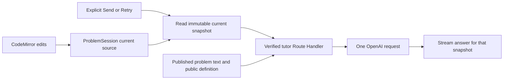

# Design

## Context

See `proposal.md` for motivation and `specs/problem-ai-tutor/spec.md` for the proposed behavior contract. This document records exploration findings and an implementation plan, not delivered behavior.

| Observed location                                                           | What exists and how it shapes this change                                                                                                                                                                             |
| --------------------------------------------------------------------------- | --------------------------------------------------------------------------------------------------------------------------------------------------------------------------------------------------------------------- |
| `features/problems/components/javascript-editor.tsx`                        | The CodeMirror document-change listener already calls the current problem's `setSource` callback. Editor state and theme compartments survive responsive remounts. No new editor-to-server synchronization is needed. |
| `features/problems/state/problem-session.tsx`                               | `sourceRef` is updated synchronously before React state, but is currently private. Account saves happen through Run/Submit. `latest` records the source and inputs belonging to an execution.                         |
| `features/problems/components/problem-experience.tsx`                       | `ProblemSession` is keyed by learner/problem. `ProblemNotesSession` already sits above adaptive layout branches. Notes reaches the generic learning shell through a ReactNode slot.                                   |
| `features/learning/components/tutor-panel.tsx` and `learning-workspace.tsx` | Existing AI tutor/Notes tabs, toolbar actions, docked panel, and mobile Sheet are present. The tutor body and Sheet description still say coming soon.                                                                |
| `packages/problems/src/types.ts` and public problem definitions             | Public definitions contain samples, constraints and callback metadata, but also full authored solutions. Sending a whole `ProblemDefinition` would include unnecessary answer material.                               |
| `content/javascript/practice/*/problem.mdx` and `statements.ts`             | Full problem prose is separate from `ProblemDefinition.summary`. Current statements are static authored Markdown with public examples; rendered React children are not a useful request contract.                     |
| `server/http.ts` and existing problem handlers                              | Protected handlers call `requireLearner`, which verifies Neon identity and origin, then use a bounded JSON reader. The execution handler demonstrates per-process frequency/concurrency controls.                     |
| `next.config.ts`                                                            | Production output tracing already includes worker assets for problem APIs. A server text loader must similarly include its authored `.mdx` assets.                                                                    |
| `apps/web/.env.local` and dependency manifests                              | A server OpenAI key is configured; its value was not displayed or used. The user confirmed they added a key, not a route. No OpenAI route or SDK dependency exists in this checkout.                                  |
| OpenSpec inventory                                                          | No main capabilities exist yet. The completed personal-notes change explicitly excludes notes from tutor context. There is no existing AI proposal to extend.                                                         |

The user confirmed session-only chat. The current branch also contains the Electron verification work and pre-existing OpenSpec material; implementation must preserve them. Leave the running local app alone during this planning review.

## Goals / Non-Goals

**Goals:** reuse the existing source of truth; make the Send action the only inference boundary; keep generic workspace composition independent of problem-specific tutor state; validate every external-call boundary; support the same online web and Electron interface.

**Non-Goals:** a second editor store, background context uploads, provider-managed conversations, chat database tables, code-editing tools, execution tools, retrieval infrastructure, or a separate Electron AI integration. The proposal lists deferred product scope.

## Decisions

### 1. Read a synchronous code snapshot at Send

Expose a narrow read-only accessor from `ProblemSession` returning `sourceRef.current`. The tutor reads it inside the explicit send/retry handler; it does not mirror code into another store, debounce uploads, or depend on account-saved code. This includes the final character even if React has not yet rendered that update. Existing restore and Reset paths already update the source ref.

Create an immutable request snapshot with a local request ID, canonical problem ID, question, source, bounded completed dialogue, and optional matching Run feedback. Keep the captured source with its turn for local stale-context comparison. Editing afterward only updates the existing local problem state and a “code changed since this question” indicator. Future sends read a fresh snapshot.

Alternative considered: listening for editor changes in the tutor and copying code into a debounced server session. That creates another source of truth and violates the requested question-triggered boundary. Depending only on the last Run/Submit also loses unsaved work.

### 2. Own chat state above the adaptive panels

Add `ProblemTutorSession` within the existing learner/problem-keyed `ProblemSession` and above `WorkspaceTools`/`LearningWorkspace`. Keep draft, turns, request controller and lifecycle in that provider. Pass `<ProblemTutor />` through a new optional `tutor` ReactNode slot, mirroring Notes. The learning shell owns tabs and responsive presentation, not problem or OpenAI imports.

One provider and at most one visible tutor body prevent duplicate streams when the drawer exits or the desktop column mounts. Closing the panel or switching Notes does not abort an answer; it remains available on reopen. Problem/account change and provider unmount abort the active request and ignore subsequent events by request ID. Reset code preserves the transcript and makes older answers visibly stale.

Chat has no storage side effects. Reload, route exit, sign-out, account/problem change and full Electron quit discard its transcript, drafts and snapshots. Run/Submit saves and Notes Save keep their existing independent behavior. Provider context sends only recent completed exchanges, not all historical code snapshots; the current source appears once as the current source.

Alternative considered: state inside `TutorPanel` or a persistent account chat. Panel-local state loses work on responsive unmount; persistent chat adds ownership, schema and retention requirements the user explicitly deferred.

### 3. Assemble authoritative public problem context on the server

Add a server-only context builder in `features/problems/server/`. Resolve the canonical problem through `findProblem` plus the existing published catalog and statement registry. Load its existing authored `problem.mdx` as inert text from a server-controlled path derived only from that allowlisted published slug. Do not serialize React children, scrape the DOM, evaluate learner input as MDX, accept a client path, or import judge/private-suite modules.

Add the statement assets to production output tracing and check their availability in a production Route Handler test. Extend content validation to ensure every published problem has a readable statement within the context budget. Cache trusted statement text per process; no generated manifest or duplicated hand-maintained problem description is needed for this slice.

Construct an allowlist projection: identity, title, topic, difficulty, entry function, statement, constraints and public samples. Resolve supplied callback names/source from the corresponding public registries for Curry, Filter, Map, Reduce, Function Composition and Memoize. Never spread a whole problem definition into a prompt; exclude `solution`, `solutionExplanation`, private notes and account data.

Include optional visible **Run** feedback only when `latest.source` equals the captured source and its input snapshot matches current parsed inputs. Send only bounded public fields, not `ExecutionResult` wholesale. Omit feedback after code/input edits, invalid current inputs, or Submit; questions remain available. The server validates/projects it again, rejects hidden-case objects, and labels it learner-supplied diagnostics rather than a trusted judge result. This path never marks progress or executes code.

Alternative considered: use only `summary`, or duplicate the statement in a tutor-specific content file. The summary omits material instructions; duplication drifts from the problem the learner actually sees. Existing static statement assets provide the full context without a new content system.

### 4. Add one authenticated, bounded tutor endpoint

Add `POST /api/problems/[problemId]/tutor` with `runtime = nodejs`, following the static Notes-route precedent beside `[action]`. The thin Route Handler delegates to a feature-owned handler. Authenticate with `requireLearner` before provider configuration, context work or external calls; use `readJson` and a strict contract that rejects extra privileged fields. History accepts user/assistant text only. Never accept a client identity, model, provider URL, API key or privileged role.

Keep all provider code guarded by `server-only`. Create the official `openai` SDK client at request time after validation, reading the existing `OPENAI_API_KEY` and an explicit `OPENAI_TUTOR_MODEL` server setting. Model selection is deployment configuration, not a learner control. Missing key/model or inaccessible configuration yields a sanitized tutor-unavailable result. Builds and public pages do not initialize a client or contact OpenAI.

Use the Responses API with a fixed tutor instruction and structured user-data context, `stream: true`, `store: false`, no tools, and SDK automatic retries disabled. Re-send bounded dialogue with each question rather than using a provider conversation or previous-response chain. Current code is explicitly authoritative over earlier suggested code. Source/comments/questions/feedback are user data, never interpolated into privileged instructions. `store: false` does not make a zero-retention promise; provider data controls still apply.

Proposed initial operational bounds, to review before live verification:

| Resource                               | Initial bound                                                                                             |
| -------------------------------------- | --------------------------------------------------------------------------------------------------------- |
| Source                                 | Existing 32 KiB UTF-8 source ceiling; empty and invalid JavaScript allowed                                |
| Current question                       | 4 KiB UTF-8, nonblank                                                                                     |
| Dialogue sent upstream                 | Latest four completed exchanges / eight messages, at most 16 KiB combined; drop oldest whole pairs        |
| Optional visible Run feedback          | 8 KiB after projection; omit excess optional diagnostics with a context-omitted indication                |
| Authored problem context               | 16 KiB, checked against every published problem                                                           |
| HTTP JSON body / assembled model input | 128 KiB / 96 KiB; clear rejection if still exceeded                                                       |
| Output                                 | 2,000 total model output tokens plus a 64 KiB text ceiling; handle token-limit/incomplete output honestly |
| Request lifetime                       | 60 seconds, combined with the incoming request's abort signal                                             |
| Tutor questions                        | 10 per minute per verified learner per Node process                                                       |
| Active work                            | One per learner and four total per Node process; no background queue                                      |

Use a dedicated tutor limiter, independent of Run/Submit. Hold its active-work lease until the stream completes, errors or is cancelled, not merely until the handler returns a streaming Response. Release in all paths and prune inactive rate entries. These are per-process controls, matching the current local-server architecture; a future replicated deployment needs shared budget enforcement before claiming an account-wide spending limit.

Alternative considered: direct browser-to-OpenAI calls or an AI agent framework. Direct calls expose server authority/credentials; an agent framework and tool runtime add capabilities this question-answering slice does not need.

### 5. Normalize streaming and deliberate recovery

Use one same-origin POST `fetch` from the tutor client, with an AbortController, to read a small SSE event contract: request start, text delta, done, and sanitized error. Translate supported provider text/lifecycle events on the server instead of forwarding raw SDK events, reasoning, tool calls, headers, or provider error bodies. Headers include `Cache-Control: no-store`. Validation/auth/configuration failures before streaming use normal JSON statuses; failures after streaming starts use an error event followed by closure.

The client has idle/sending/streaming/completed/stopped/failed states. Distinguish successful completion from refusal, empty output, token-limit interruption and transport closure. Partial text stays readable but is marked incomplete/stopped and excluded from completed history. Stop cancels work where possible; navigation/account changes also abort. No EventSource auto-reconnect, background retry, automatic model fallback or AI summarization runs.

Retry is labeled **Retry with current code**. It reuses the failed question, reads a fresh code snapshot and assigns a new request ID without duplicating that user turn. Ignore late events from the replaced attempt. Keep any newer composer draft independent of the retried question. Only completed question/answer pairs enter later history; trimming changes provider context, not the visible session transcript.

### 6. Fit the existing tutor tab and preserve learner control

Keep the existing panel header, AI/Notes tab behavior, native toolbar buttons and mobile focus restoration. Provide a scrollable transcript, labeled multiline question field, shared Send/Stop/Retry buttons, and status/error text. Enter inserts a newline; Mod-Enter submits the focused question form. CodeMirror's existing Mod-Enter Run behavior remains unchanged. Introduce a shared textarea primitive in `packages/ui` only if needed, following its existing Field/Input conventions.

Display concise context/lifetime copy near the composer: current code and problem are included when sending; chat lasts for this visit. Use safe Markdown rendering for paragraphs, lists, inline code and fenced code; disable raw HTML and images, constrain links, contain long code horizontally, and use semantic theme tokens. Prefer `react-markdown` without syntax-highlighting plugins; existing trusted MDX rendering is inappropriate for model output. Keep external links compatible with Electron's HTTPS policy.

The proposed default instruction is hint-first, concise teaching anchored to the supplied code, with fuller solutions only on explicit request. Responses never insert editor text, invoke Run/Submit, save progress, read notes, or claim verified acceptance. This is a proposed tutoring policy for review, not an enforced guarantee of model quality; assess representative real replies after implementation.

## Risks / Trade-offs

- Stale snapshots or cross-problem responses → synchronous source getter, immutable per-question snapshot, identity-keyed provider and request-ID checks; test immediate Send and edits during streaming.
- State loss or duplicate requests when switching layouts → state above panel branches and one mounted tutor body; test hide/Notes/theme/mobile transitions while streaming.
- Missing statement assets in production → explicit output tracing, catalog validation, and production endpoint verification across all published definitions, not development-only filesystem evidence.
- Prompt/output misuse or inadvertent private-context disclosure → public-field projection, no judge/notes imports, strict history roles, inert rendering and no tools; test request construction without claiming prompt-injection immunity.
- Cost, latency, or service failure → one attempt per explicit action, bounded inputs/output/time, per-process limits, Stop and deliberate Retry. These controls are not a monetary budget or a provider-availability guarantee.
- Long conversations lose earlier provider context → retain visible history but send only recent exchanges with a clear notice; no surprise summarization call.
- SDK/Markdown dependency cost → keep OpenAI server-only, omit highlighting plugins, review the bundle through the existing analyzer and confirm credentials/private modules stay outside browser and desktop archives.

## Migration Plan

1. Review this proposal and tutoring defaults before starting `openspec-apply-change`. There is no existing integration to migrate and no database migration is required.
2. After approval, record the feature brief and chosen accessible model, add server dependencies/configuration examples without replacing existing credentials, implement one Counter journey, then check the same context path against all thirteen published problems.
3. Verify mocked contracts and browser journeys without paid requests, then separately run a small real signed-in browser and Electron review using the configured development setup. Keep the user's running server, personal account/code/notes and existing branch edits intact; production suites require free port 3000 and a coordinated server stop/restart.
4. Run root lint/typecheck/test, a credential-free build and smoke suite, authenticated tutor journeys and bundle review. Record actual evidence separately from unverified model quality or packaged-app checks.
5. Roll back by removing the tutor slot/endpoint/provider modules and dependencies; no chat tables or saved learner data need rollback. Existing notes and practice APIs remain independent.

## Decisions confirmed during implementation

- `OPENAI_TUTOR_MODEL=gpt-5.4-mini` is accessible to the configured project and was used for live browser/Electron review, with the specified output cap and per-process limits.
- Initial review found an overly complete first hint. The instruction now requests one code-specific hint of at most 100 words for vague first questions, ends with a guiding question, and reserves full solutions for explicit requests. Final browser/Electron samples followed this policy. This remains model guidance rather than a deterministic answer-quality guarantee.

## Primary API References

Checked on 2026-11-14; no OpenAI inference request was made during exploration.

- [OpenAI text generation](https://developers.openai.com/api/docs/guides/text): Responses API for direct text-generation requests.
- [Streaming responses](https://developers.openai.com/api/docs/guides/streaming-responses): text-delta and completion/error lifecycle events.
- [Conversation state](https://developers.openai.com/api/docs/guides/conversation-state): explicitly supplied history and stateless request options.
- [Data controls](https://developers.openai.com/api/docs/guides/your-data): provider retention is distinct from the app's session-only conversation lifetime.

## Planning Verification (historical, before implementation)

- OpenSpec reports all four planning artifacts complete; strict change validation passes without issues. Implementation tasks remain unchecked.
- Biome checks pass for this change's artifacts. Root `pnpm lint` reports only four unrelated `.obsidian/*.json` formatting errors; those files were left untouched.
- All 327 files present in the planning baseline retain their original content hashes. No application code, dependencies, credentials or existing branch edits changed. No inference call or implementation/browser test was run for this proposal.

Implementation was subsequently authorized on 2026-11-14. See [the feature brief](../../../docs/features/problem-ai-tutor.md) for completed checks, live observations and the remaining manual packaged-app review.
